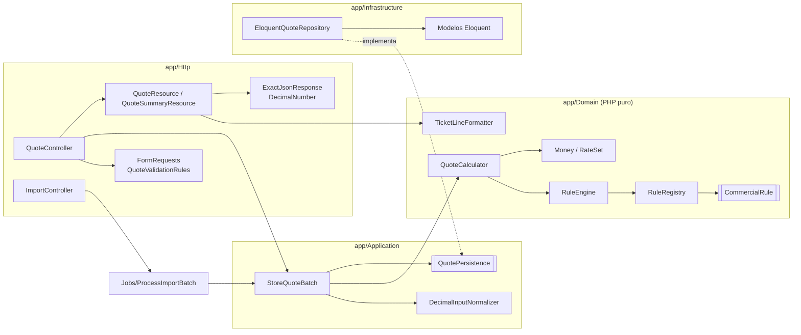
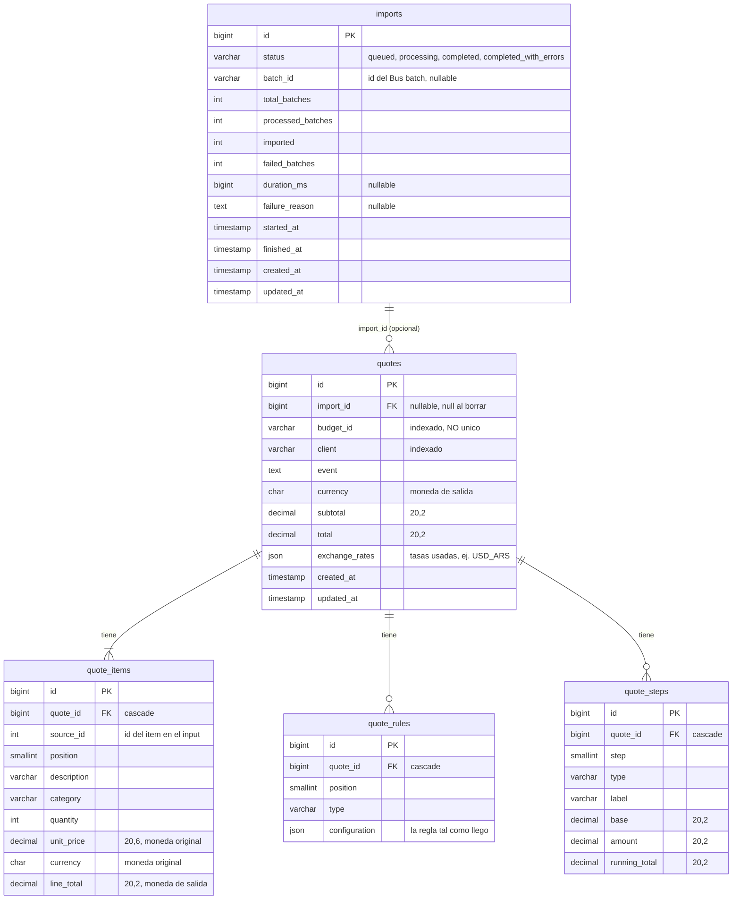
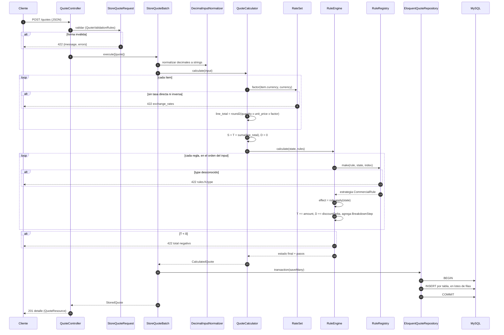
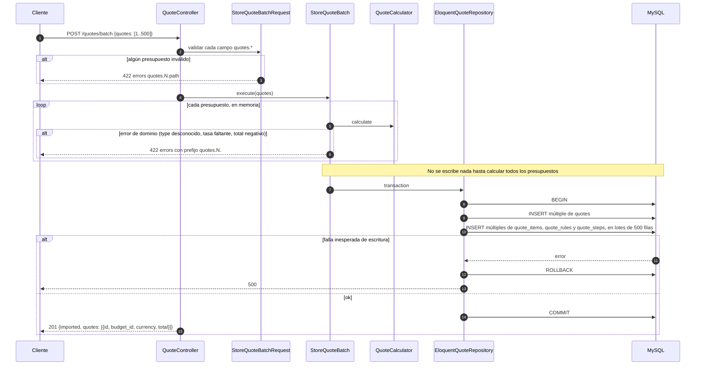
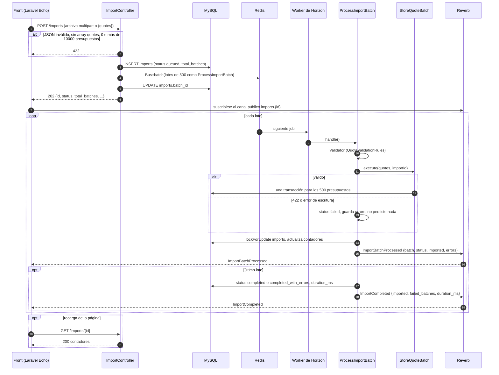
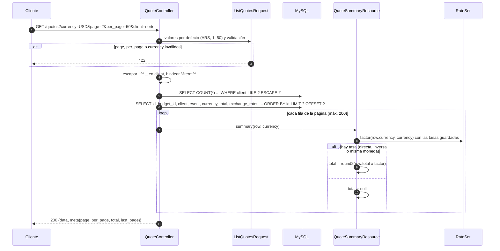
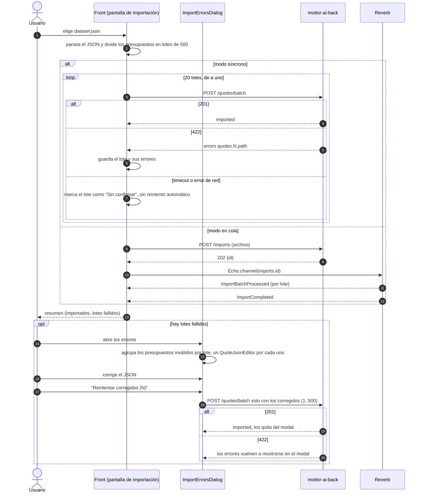

# mottor-ai-back

[](https://github.com/Juanperezc/mottor-ai-back/releases)
[](#tests-y-validación-del-dataset)
[](#tests-y-validación-del-dataset)
[](https://www.php.net/)
[](https://laravel.com/)
[](https://www.mysql.com/)
[](https://mottor.tulinkfacil.com/)

API en Laravel 13 para el desafío de presupuestos de Mottor AI. Calcula presupuestos de eventos (quotes) con un pipeline ordenado de reglas comerciales y guarda el resultado con su desglose completo. También lista el histórico en cualquier moneda e importa el dataset de 10.000 presupuestos, de forma síncrona o mediante una cola con progreso en vivo.

| Capa | Elección |
| --- | --- |
| Runtime | PHP 8.5 (`"php": "^8.5"`), Laravel 13.39 |
| Base de datos | MySQL 8.4, `utf8mb4` / `utf8mb4_0900_ai_ci` |
| Entorno local | Laravel Sail (Docker) |
| Cola | Redis + Laravel Horizon (`QUEUE_CONNECTION=redis`) |
| Tiempo real | Laravel Reverb (`BROADCAST_CONNECTION=reverb`), consumido por el front con Laravel Echo |
| Dinero | `brick/math` (`BigDecimal`), redondeo configurable (`HALF_UP` por defecto), nunca `float` |
| Documentación de la API | Scramble (`dedoc/scramble`) en `/docs/api` |
| Tests | PHPUnit 12 con `php artisan test` |
| Estilo | Laravel Pint |

## Demo y enunciado

| Qué | Dónde |
| --- | --- |
| API (este repo) | https://mottor.tulinkfacil.com/ |
| Front ([`mottor-ai-front`](https://github.com/Juanperezc/mottor-ai-front)) | https://mottor-ai-front.vercel.app/ (la app arranca en [`/quotes`](https://mottor-ai-front.vercel.app/quotes)) |
| Enunciado del challenge | [`docs/enunciado.html`](docs/enunciado.html) (_Mottor.ai Senior Full-Stack Challenge_: "Calculadora de presupuestos con reglas comerciales") |
| Specs (SDD) | [`mottor-ai-specs`](https://github.com/Juanperezc/mottor-ai-specs) |

El enunciado es el HTML original, sin cambios. GitHub lo muestra como código: para leerlo con formato, descargalo y abrilo en el navegador. La API no tiene prefijo `/api`: los endpoints cuelgan de la raíz (por ejemplo, `GET /health` y `GET /quotes`).

## Contenido

- [Demo y enunciado](#demo-y-enunciado)
- [Estructura de la entrega](#estructura-de-la-entrega)
- [Fuente de verdad](#fuente-de-verdad)
- [Cómo correrlo con Sail](#cómo-correrlo-con-sail)
- [Cómo cargar datos de desarrollo](#cómo-cargar-datos-de-desarrollo)
- [API](#api)
- [Documentación de la API (Scramble)](#documentación-de-la-api-scramble)
- [Arquitectura](#arquitectura)
- [Modelo de datos](#modelo-de-datos)
- [Flujos](#flujos)
- [Decisiones de cálculo](#decisiones-de-cálculo)
- [Cómo agregar una regla](#cómo-agregar-una-regla)
- [Type de regla desconocido](#type-de-regla-desconocido)
- [El listado y su SQL](#el-listado-y-su-sql)
- [Tests y validación del dataset](#tests-y-validación-del-dataset)
- [Qué quedó afuera](#qué-quedó-afuera)
- [Cómo contribuir](#cómo-contribuir)
- [Versionado y releases](#versionado-y-releases)

## Estructura de la entrega

El [enunciado](docs/enunciado.html) pide un único repositorio con las carpetas `api/` y `web/`. Por decisión de Juan ([ADR-00](https://github.com/Juanperezc/mottor-ai-specs/blob/main/docs/decisions.md)), el proyecto se entrega en dos repositorios separados:

- **Back (este repositorio):** [`mottor-ai-back`](https://github.com/Juanperezc/mottor-ai-back), la API en Laravel.
- **Front:** [`mottor-ai-front`](https://github.com/Juanperezc/mottor-ai-front), la aplicación en React.
- **Specs:** [`mottor-ai-specs`](https://github.com/Juanperezc/mottor-ai-specs), con la constitución, las especificaciones y los planes de ambos.

Cada repositorio tiene su propio README y su propio `AI.md`.

## Fuente de verdad

Este repositorio sigue Spec-Driven Development. La constitución, la especificación, el plan y las tareas viven únicamente en [`mottor-ai-specs`](https://github.com/Juanperezc/mottor-ai-specs). Este README los enlaza, pero no los copia.

- [Constitución](https://github.com/Juanperezc/mottor-ai-specs/blob/main/.specify/memory/constitution.md)
- [Especificación funcional](https://github.com/Juanperezc/mottor-ai-specs/blob/main/specs/001-quotes-mvp/spec.md)
- [Plan, modelo de datos y endpoints](https://github.com/Juanperezc/mottor-ai-specs/blob/main/specs/001-quotes-mvp/plan.md) y [tareas del back (BT-xx)](https://github.com/Juanperezc/mottor-ai-specs/blob/main/specs/001-quotes-mvp/tasks.md)
- [Decisiones de arquitectura (ADR)](https://github.com/Juanperezc/mottor-ai-specs/blob/main/docs/decisions.md)

Si el código y el [enunciado](docs/enunciado.html) contradicen las specs, prevalecen el enunciado y las decisiones de arquitectura registradas, y la spec se actualiza primero.

El contrato de la API se genera desde el código con Scramble y se versiona en [`docs/api/openapi.json`](docs/api/openapi.json).

## Cómo correrlo con Sail

La única dependencia del host es Docker. Nunca se usa la versión de PHP del host.

```bash
# Solo en el primer clone: instalar dependencias de Composer sin PHP local
docker run --rm -u "$(id -u):$(id -g)" -v "$(pwd):/var/www/html" -w /var/www/html \
  laravelsail/php84-composer:latest composer install --ignore-platform-reqs

cp .env.example .env
./vendor/bin/sail build
./vendor/bin/sail up -d
./vendor/bin/sail artisan key:generate
./vendor/bin/sail artisan migrate
```

La imagen `laravelsail/php84-composer` se usa solo para instalar Composer en el primer clone, con los requisitos de plataforma omitidos. La aplicación se construye y ejecuta con PHP 8.5 desde `vendor/laravel/sail/runtimes/8.5`, como define `compose.yaml`; Sail no publica una imagen `php85-composer`.

`compose.yaml` levanta estos servicios:


| Servicio       | Qué ejecuta                                         | Puerto en el host                              |
| -------------- | ---------------------------------------------------- | ---------------------------------------------- |
| `laravel.test` | La API (`http://localhost:8000`)                     | `APP_PORT`, por defecto `8000`                 |
| `horizon`      | `php artisan horizon` (workers de la cola)           | —                                             |
| `reverb`       | `php artisan reverb:start --port=8080`               | `REVERB_SERVER_PORT`, `8081` en `.env.example` |
| `mysql`        | MySQL 8.4 con `--collation-server=utf8mb4_0900_ai_ci` | `FORWARD_DB_PORT`, por defecto `3306`          |
| `redis`        | Redis                                                | `FORWARD_REDIS_PORT`, por defecto `6379`       |

- Panel de Horizon: `http://localhost:8000/horizon`, solo en el entorno local.
- El front conecta Echo a Reverb en `ws://localhost:8081` con la key `mottor-ai-key` (ver `.env.example`).
- El dataset del desafío se monta en solo lectura en `/inputs` desde `DATASET_PATH` (por defecto `../_inputs`).

## Cómo cargar datos de desarrollo

El seeder por defecto genera 300 presupuestos coherentes mediante el mismo `StoreQuoteBatch` que usa `POST /quotes`. Incluye distintos clientes —también nombres con acentos—, ítems en ARS, USD y EUR, los seis tipos de regla y presupuestos sin tasa de conversión a USD.

```bash
./vendor/bin/sail artisan migrate:fresh --seed
```

La cantidad se configura en `.env`; el valor por defecto deja seis páginas de 50 filas:

```dotenv
SEED_QUOTES=300
```

Para cargar el dataset completo sin versionar sus 10 MB, montalo mediante `DATASET_PATH` y ejecutá el seeder opcional. `DATASET_SEED_PATH` es la ruta dentro del contenedor y por defecto apunta al archivo montado en `/inputs/dataset.json`:

```dotenv
DATASET_PATH=../_inputs
DATASET_SEED_PATH=/inputs/dataset.json
```

```bash
./vendor/bin/sail artisan migrate:fresh
./vendor/bin/sail artisan db:seed --class=DatasetSeeder
```

`DatasetSeeder` usa el camino batch/bulk de la aplicación en bloques de 500 presupuestos.

Para probar la importación desde el front, hay datasets chicos con el mismo formato (válidos, con errores, casos de ticket y archivos mal formados) en [`database/datasets/`](database/datasets/README.md). Su README explica qué resultado esperar de cada uno.

## API

- Todos los endpoints se sirven en la raíz, sin prefijo `/api` (`apiPrefix: ''` en `bootstrap/app.php`).
- Reciben y devuelven JSON, con claves en `snake_case`.
- Los montos son números JSON con exactamente dos decimales (por ejemplo `4722388.00`). `ExactJsonResponse` los emite literalmente, así que nunca intervienen `float`.
- En la entrada, `DecodeExactJsonNumbers` toma cada token numérico del cuerpo JSON crudo como string decimal antes de validar; `DecimalInputNormalizer` rechaza cualquier `float` que llegue por otro camino.


| Método | Ruta                                                   | Resultado                                                                                              |
| ------- | ------------------------------------------------------ | ------------------------------------------------------------------------------------------------------ |
| `GET`   | `/health`                                              | `200 {"status":"ok"}`                                                                                  |
| `POST`  | `/quotes`                                              | `201` con el detalle y su `breakdown`                                                                  |
| `POST`  | `/quotes/batch`                                        | `201 {"imported": n, "quotes": [{id, budget_id, currency, total}]}`; de 1 a 500 presupuestos, atómico |
| `GET`   | `/quotes?currency=ARS&page=1&per_page=50&client=norte` | `200 {data, meta{page, per_page, total, last_page}}`                                                   |
| `GET`   | `/quotes/{id}`                                         | `200` con el detalle, `404 {"message"}`                                                                |
| `POST`  | `/imports`                                             | `202 {id, status, total_batches, processed_batches, imported, failed_batches, duration_ms}`            |
| `GET`   | `/imports/{id}`                                        | `200` con la misma forma; sirve para retomar el progreso después de recargar                          |

- **Errores de validación:** `422 {"message": "...", "errors": {"path": ["msg"]}}`. En un lote las rutas llevan prefijo, por ejemplo `quotes.137.rules.1.percent`.
- **CORS** (`config/cors.php`): métodos `GET`, `POST` y `OPTIONS`; header `Content-Type`; origen único configurado mediante `FRONTEND_URL`.
- **Valores por defecto de `GET /quotes`:** `currency=ARS`, `page=1`, `per_page=50`. `per_page` debe estar entre 1 y 200 y `currency` debe ser de tres letras mayúsculas; si no, responde 422.
- El detalle y el listado exponen `event_lines` y `description_lines`: el texto partido en hasta 4 líneas de 28 caracteres para el ticket impreso (ver [Líneas del ticket](#líneas-del-ticket)).

## Documentación de la API (Scramble)

- Swagger UI: `http://localhost:8000/docs/api`
- OpenAPI en JSON: `http://localhost:8000/docs/api.json`
- Rutas documentadas: `health`, `quotes` e `imports` (`config/scramble.php`).

Las respuestas se construyen con `QuoteResource`, `QuoteSummaryResource`, `QuoteBatchResource` e `ImportResource`. Scramble documenta los recursos y sus formas con atributos `#[Response]` en `QuoteController` e `ImportController`. Después de cualquier cambio en la API, regenerá el contrato versionado:

```bash
./vendor/bin/sail artisan scramble:export --path=docs/api/openapi.json
```

## Arquitectura



- `app/Domain` no depende de Laravel, Eloquent, SQL ni HTTP. Su única dependencia es `brick/math`.
- `app/Application/Contracts/QuotePersistence` se enlaza con `EloquentQuoteRepository` en `AppServiceProvider`.
- Las seis estrategias están en `app/Domain/Rules/Strategies`: `QuantityPromoRule`, `CategoryDiscountRule`, `PercentageDiscountRule`, `FixedDiscountRule`, `DiscountCapRule` y `TaxRule`.

## Modelo de datos

- Migraciones: un archivo por tabla para `imports`, `quotes`, `quote_items`, `quote_rules` y `quote_steps` en `database/migrations/`.
- Los montos son `decimal(20,2)`. Los precios unitarios admiten hasta seis decimales (`decimal(20,6)`) para guardar el input exacto.
- La collation es `utf8mb4_0900_ai_ci`.



- `budget_id` no es único a propósito: el desafío no deduplica, y el mismo presupuesto puede importarse dos veces.
- Cada presupuesto guarda las tasas exactas con las que se calculó, así el listado nunca depende de las tasas del día.
- `quote_steps` guarda una fila por regla, aunque el monto sea `0.00`.

## Flujos

### 1. `POST /quotes`



El tope de descuentos es la única regla que mira `D`:

- `limit = round2(S x max_percent / 100)`
- `refund = max(0, D - limit)`
- Luego `T += refund` y `D -= refund`.

Los impuestos cambian `T` pero nunca `D`.

### 2. `POST /quotes/batch` (síncrono y atómico)



Un 422 no guarda nada de ese lote. Si un lote tiene un presupuesto válido junto a uno inválido, se rechaza entero.

### 3. `POST /imports` (en cola, con Horizon y Reverb)



- Los dos eventos implementan `ShouldBroadcastNow` y usan `broadcastAs()`. Por eso Echo escucha con un punto adelante: `.listen('.ImportBatchProcessed', ...)`.
- `ImportBatchProcessed.status` vale `processed` o `failed`.
- `errors` usa el formato del 422, con rutas relativas al lote (`quotes.137.rules.1.percent`). El front calcula el índice global como `(batch - 1) x 500 + 137`.
- No hay cancelación ni deduplicación por `budget_id`.

### 4. `GET /quotes`



### 5. Front: importar `dataset.json` y corregir errores



Los presupuestos válidos que compartían lote con uno inválido no se guardaron, porque el lote es atómico. Se reintentan junto con los corregidos.

## Decisiones de cálculo

### Dinero y redondeo

- Toda la aritmética usa `BigDecimal` de `brick/math`. El value object `Money` siempre tiene escala 2.
- El modo se define en `config/money.php` mediante `MONEY_ROUNDING_MODE`; el valor por defecto es `HALF_UP`. El contenedor lo convierte en `Brick\Math\RoundingMode` y lo inyecta en el dominio puro y en `QuoteSummaryResource`, incluida la conversión de `GET /quotes`. Se aceptan `UP`, `DOWN`, `CEILING`, `FLOOR`, `HALF_UP`, `HALF_DOWN`, `HALF_CEILING`, `HALF_FLOOR`, `HALF_EVEN` y `HALF_ODD`.

Dónde se redondea:

- `line_total = round2(quantity x unit_price x factor)`, calculado exacto y redondeado una sola vez.
- `subtotal` es la suma de los `line_total` ya redondeados.
- El monto de cada regla se redondea una vez antes de modificar `T`.
- El límite del tope, `round2(S x max_percent / 100)`, también se redondea.
- La promo por cantidad suma el valor exacto de todas las unidades bonificadas y redondea una sola vez.
- Las tasas inversas se calculan como `1 / rate` con 12 decimales y el modo configurado.

### Conversión

- Las claves de tasas son `FROM_TO`, por ejemplo `USD_ARS`.
- Con la tasa directa se multiplica. Si solo existe la inversa, se divide. Misma moneda: identidad, aunque no haya tasas.
- No hay triangulación: no se intenta convertir `EUR` a `USD` pasando por `ARS`.
- Si falta una tasa: 422 al escribir y `null` en el listado.

### Reglas

- Las reglas se aplican en el orden en que llegan. El código nunca asume una secuencia fija.
- `RuleEngine` mantiene tres acumuladores en `CalculationState`:
  - `S` (`listSubtotal`): el subtotal a precio de lista, inmutable.
  - `T` (`total`): el total acumulado.
  - `D` (`discounts`): los descuentos netos hasta ese punto.
- Cada estrategia devuelve un `RuleEffect {base, amount, discountDelta, label}`.


| Type                  | Base                            | Monto                                                            | Efecto sobre `D` |
| --------------------- | ------------------------------- | ---------------------------------------------------------------- | --------------- |
| `quantity_promo`      | valor de lista de la categoría | `-(floor(qty / buy) x (buy - pay) x precio unitario)`, por ítem | `+descuento`    |
| `category_discount`   | valor de lista de la categoría | `-round2(base x percent / 100)`                                  | `+descuento`    |
| `percentage_discount` | `T` actual                      | `-round2(T x percent / 100)`                                     | `+descuento`    |
| `fixed_discount`      | `T` actual                      | `-round2(amount x factor)`                                       | `+descuento`    |
| `discount_cap`        | `S`                             | `+max(0, D - round2(S x max_percent / 100))`                     | `-reintegro`    |
| `tax`                 | `T` actual                      | `+round2(T x percent / 100)`                                     | ninguno         |

Cada estrategia construye su propio `label` desde la configuración, con números en formato es-AR: `3x2 en mobiliario`, `15% en catering`, `10% general`, `ARS 50.000`, `Tope 20%` e `IVA 21%`.

- Los grupos incompletos de una promo se pagan. Con 16 mesas en 3x2 se bonifican 5 y la que sobra se paga. Los grupos se cuentan por ítem, nunca sumando toda la categoría.
- Los impuestos nunca cuentan para el tope, vayan antes o después. Por eso el tope no anula un impuesto aplicado antes que él.
- Un total final negativo se rechaza con 422.

### Casos resueltos

**Caso oficial** (`PRE-2026-0418`, ARS). El código lo reproduce exacto, y `QuoteCalculatorTest` verifica cada monto.


| # | Type                |         Base |       Monto |    Acumulado |
| - | ------------------- | -----------: | ----------: | -----------: |
| 1 | quantity_promo      |   358.500,00 | -119.500,00 | 4.759.000,00 |
| 2 | category_discount   | 2.610.000,00 | -391.500,00 | 4.367.500,00 |
| 3 | percentage_discount | 4.367.500,00 | -436.750,00 | 3.930.750,00 |
| 4 | fixed_discount      | 3.930.750,00 |  -50.000,00 | 3.880.750,00 |
| 5 | discount_cap        | 4.878.500,00 |  +22.050,00 | 3.902.800,00 |
| 6 | tax                 | 3.902.800,00 | +819.588,00 | 4.722.388,00 |

Subtotal 4.878.500,00 y total **4.722.388,00**. Listado en USD con su `USD_ARS = 1450` guardado: 3.256,82.

**Segundo caso** (`PRE-2026-0419`, sin resultado publicado). Acá el impuesto va **antes** del tope.


| # | Type                           |         Base |         Monto |    Acumulado |
| - | ------------------------------ | -----------: | ------------: | -----------: |
| 1 | quantity_promo 3x2 mobiliario  |   369.800,00 |   -119.500,00 | 7.807.725,00 |
| 2 | category_discount 15% catering | 2.610.000,00 |   -391.500,00 | 7.416.225,00 |
| 3 | percentage_discount 12,5%      | 7.416.225,00 |   -927.028,13 | 6.489.196,87 |
| 4 | fixed_discount USD 100         | 6.489.196,87 |   -143.735,00 | 6.345.461,87 |
| 5 | tax IVA 21%                    | 6.345.461,87 | +1.332.546,99 | 7.678.008,86 |
| 6 | discount_cap 18%               | 7.927.225,00 |   +154.862,63 | 7.832.871,49 |

Subtotal 7.927.225,00 y total **7.832.871,49**. Las decisiones detrás de estos números:

- **Redondeo:** cada `line_total` se redondea una vez (la pantalla en EUR: 850 x 1562,10 = 1.327.785,00) y después cada paso. El paso 3 da 927.028,125, que con `HALF_UP` queda en 927.028,13.
- **Conversión:** el descuento fijo de USD 100 usa `USD_ARS` directa: 143.735,00.
- **Grupos incompletos:**
  - 16 mesas bonifican 5 (47.500,00).
  - 121 sillas bonifican 40 (72.000,00).
  - Las unidades que sobran se pagan.
- **Impuesto vs tope:**
  - `D` = 1.581.763,13.
  - Límite = 18% de 7.927.225,00 = 1.426.900,50.
  - Reintegro: 154.862,63.
  - El IVA (1.332.546,99) se calcula sobre el total ya descontado y no forma parte de `D`, así que el tope no lo reintegra ni lo limita.

### Líneas del ticket

`TicketLineFormatter` parte el texto en hasta 4 líneas de 28 caracteres:

- Corte greedy por palabras.
- Las palabras de más de 28 caracteres se parten.
- Si el texto no entra, la 4.ª línea queda como `rtrim(primeros 27 caracteres) + "…"`.
- El ancho se cuenta en code points Unicode (`mb_*`), no en bytes.

## Cómo agregar una regla

1. Crear una clase en `app/Domain/Rules/Strategies` que implemente `App\Domain\Rules\CommercialRule`:

   ```php
   final readonly class MyNewRule implements CommercialRule
   {
       public function __construct(array $configuration)
       {
           // validate fields with RuleConfiguration::string/integer/decimal/percent
       }

       public function apply(CalculationState $state): RuleEffect
       {
           // return new RuleEffect(base, amount, discountDelta, label)
       }
   }
   ```

   - Un descuento devuelve un `amount` negativo y el mismo valor positivo en `discountDelta`.
   - Un recargo o impuesto devuelve un `amount` positivo y `discountDelta` en cero.
2. Registrar su type en el mapa de closures de `RuleRegistry`, en `AppServiceProvider::register()`:

   ```php
   'my_new_rule' => fn (array $config, CalculationState $state) => new MyNewRule($config),
   ```
3. Si la regla tiene campos nuevos, agregarlos a `QuoteValidationRules`. Los campos decimales van también en `DecimalInputNormalizer`, para que lleguen al dominio como strings exactos desde `ExactJsonDecoder`.
4. Agregar un test unitario aislado en `tests/Unit/Domain/Rules/`.

`RuleEngine`, `QuoteCalculator` y las estrategias existentes no cambian.

## Type de regla desconocido

Cuando no hay factory para el type, `RuleRegistry::make()` lanza `DomainValidationException`. El exception handler de `bootstrap/app.php` lo convierte en esta respuesta, con status 422:

```json
{
  "message": "The given data was invalid.",
  "errors": { "rules.0.type": ["The rule type 'future_rule' is not supported."] }
}
```

- En `/quotes/batch` y en las importaciones en cola, la ruta pasa a ser `quotes.N.rules.M.type` y se rechaza el lote completo.
- No se persiste nada.

## El listado y su SQL

`GET /quotes` ejecuta exactamente una consulta de conteo y una de página. La conversión se hace en PHP solo para la página (hasta 200 filas), con las `exchange_rates` guardadas en cada presupuesto. No hay join ni consultas por fila.

```sql
SELECT COUNT(*) AS aggregate
FROM quotes
WHERE client LIKE ? ESCAPE '!';

SELECT id, budget_id, client, event, currency, total, exchange_rates
FROM quotes
WHERE client LIKE ? ESCAPE '!'
ORDER BY id ASC
LIMIT ? OFFSET ?;
```

- Sin `client`, las dos consultas van sin `WHERE`.
- El valor bindeado es `%term%`, con `!`, `%` y `_` escapados con `!`, así el término siempre es un substring literal.
  - Se eligió `!` como carácter de escape explícito y se verifica contra el mismo MySQL 8.4 usado por la aplicación.
- `utf8mb4_0900_ai_ci` hace que la búsqueda no distinga mayúsculas ni acentos (`norte` encuentra `Agencia Norte`).
- `client` está indexado, pero un `LIKE '%x%'` con comodín al principio no puede usar un índice B-tree. Para 10.000 filas un scan alcanza; con más volumen, el paso siguiente sería un índice full-text o n-gram.
- `total` es `null` cuando las tasas del presupuesto no permiten convertir a la moneda pedida. Por ejemplo, un presupuesto en EUR que solo guardó `EUR_ARS`, listado en USD.

## Tests y validación del dataset

```bash
./vendor/bin/sail artisan test
./vendor/bin/sail artisan test --coverage --min=80
./vendor/bin/sail artisan quotes:validate-dataset /inputs/dataset.json
./vendor/bin/sail pint --test
```

- Los tests corren exclusivamente sobre la base MySQL `testing` de Sail; `phpunit.xml` no configura SQLite. Para aislar efectos, usa `QUEUE_CONNECTION=sync` y `BROADCAST_CONNECTION=null`.
- Los datasets para probar la importación de punta a punta (desde el front o con `quotes:validate-dataset`) están en [`database/datasets/`](database/datasets/README.md), con el resultado esperado de cada archivo.
- Las fixtures se mantienen únicamente en `tests/Fixtures/` de este repositorio; se copiaron de `mottor-ai-specs@3ef1401a69e29d831d43ba67364c10858c6a2865` y conservan los mismos IDs BT. Los tests leen desde esa carpeta.
- **Unitarios:**
  - `MoneyTest`.
  - `RateSetTest`: tasa directa, inversa, ausencia y prohibición de triangulación.
  - `QuoteCalculatorTest`: casos oficial y segundo completos, los seis labels, type desconocido y cambio de modo de redondeo.
  - `Rules/*Test`: cada estrategia aislada, reglas sin coincidencias, topes consecutivos y `FakeRule` registrada solo en el test.
  - `ExactJsonInputTest`: preservación del literal JSON y rechazo explícito de `float`.
  - `TicketLineFormatterTest`: los 17 casos oficiales de ticket.
- **De feature:**
  - `QuoteApiTest`: fixtures oficiales, decimal grande exacto, paths 422 por índice/campo, límite de 500, snapshot de detalle, listado, atomicidad, SQL, CORS y paginación extrema.
  - `ImportApiTest`: multipart, límite de 10.000, importación real de 1.200 en tres lotes, lote fallido atómico y canal/payload/conteo de eventos.
  - `DatabaseSeederTest`: factories, paginación, filtro sin acentos, monedas, reglas y total `null` por tasa faltante.
  - `ValidateDatasetCommandTest`: cálculo del dataset sin escrituras y error por archivo inexistente.
- `quotes:validate-dataset` calcula todos los presupuestos sin persistir. Sobre el dataset de 10.000 presupuestos reporta:
  - cero presupuestos inválidos;
  - cero totales negativos;
  - un total mínimo de `0.58` (`PRE-2026-0679`).

Última ejecución completa (2026-10-28, Sail con MySQL, `php artisan test --coverage` con PCOV): **61 tests y 436 aserciones**, todos en verde; cobertura total **94,3 %**. `pint --test` pasa sin cambios.

## Qué quedó afuera

- Autenticación y autorización.
- Deploy y CI.
- Triangulación de monedas y monedas sin centavos.
- Edición y borrado de presupuestos.
- Deduplicación por `budget_id`.
- Cancelación de una importación en cola.
- Streaming del upload: `POST /imports` decodifica el archivo entero en memoria (hasta 10.000 presupuestos y 50 MB).
- Tests end-to-end del front. El front en React está en [`mottor-ai-front`](https://github.com/Juanperezc/mottor-ai-front).

## Cómo contribuir

- Ramas: `feat/...` desde `staging`, PR a `staging`, y PR de release de `staging` a `main`.
- Commits: Conventional Commits con footers `Spec:` y `Tasks:` que apuntan a `mottor-ai-specs`.
- Ver [AGENTS.md](AGENTS.md) para el flujo de trabajo y las reglas de calidad del repositorio, y [AI.md](AI.md) para cómo se usó IA.

## Versionado y releases

Las versiones siguen [SemVer](https://semver.org/) (`vX.Y.Z`) y se calculan solas a partir de los commits en [Conventional Commits](https://www.conventionalcommits.org/) que están en `staging` y todavía no en `main`:

| Commits pendientes                                  | Bump                     |
| --------------------------------------------------- | ------------------------ |
| `tipo!:` o un footer `BREAKING CHANGE:`             | major (minor mientras sea `0.x`) |
| `feat`                                              | minor                    |
| `fix`, `perf`, `refactor`, `revert`                 | patch                    |
| solo `docs`, `chore`, `test`, `ci`, `style`, `build` | patch                    |

Se parte del último tag `vX.Y.Z` alcanzable desde `main` (o de `v0.0.0` si no hay ninguno). Mientras la versión sea `0.x`, un cambio incompatible sube el minor en lugar del major.

Cómo funciona ([`.github/workflows/release.yml`](.github/workflows/release.yml)):

1. Cada push a `staging` corre [`scripts/release-pr.sh`](scripts/release-pr.sh), que abre o actualiza un único PR `staging` → `main` con la label `release`, el título `release: vX.Y.Z` y las notas agrupadas (¿Qué hay de nuevo?, Correcciones, Otros). Si `staging` no tiene cambios respecto de `main`, cierra ese PR.
2. Al mergear el PR de release, [`scripts/release-tag.sh`](scripts/release-tag.sh) crea el tag anotado `vX.Y.Z` sobre el merge commit de `main` y la GitHub Release con las mismas notas. Después adelanta `staging` hasta `main` si es fast-forward; si no, lo deja como está y avisa en el log.

El PR de release se mergea con **merge commit**, no con squash ni rebase: así los commits de `staging` quedan en `main` y el historial no se rompe.

Para verlo a mano sin tocar GitHub (solo hace falta `git` y `gh` autenticado):

```bash
./scripts/release-pr.sh --dry-run                 # versión y notas que calcularía
./scripts/release-pr.sh                           # crea o actualiza el PR de release
./scripts/release-tag.sh <número-de-PR> --dry-run # qué tag y release crearía
```
